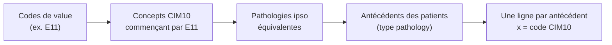

# `CIM10` : antécédents codés en CIM10

{{ bloc_resume("CIM10") }}

## Ce que fait le bloc

Recherche dans les **antécédents** du patient les pathologies correspondant à des codes CIM10. Par
défaut, il garde les patients ayant au moins un de ces antécédents.

## Données utilisées

| Table | Colonnes | Rôle |
| --- | --- | --- |
| `concept` | `concept_id`, `concept_code`, `concept_vocabulary` | Codes CIM10 (`cim10`) et pathologies ipso (`ipso_pathology`). |
| `concept_relationship` | `concept_id_1`, `concept_id_2` | Correspondance CIM10 → pathologie ipso. |
| `patient_condition` | `patient_id`, `patient_condition_id`, `patient_observation_id`, `condition_concept_id`, `condition_concept_type` | Pathologies reconnues dans les antécédents. |
| `patient_observation` | `patient_observation_id`, `patient_observation_label` | Rubrique du dossier où l'antécédent est écrit. |
| `patient_condition_date` | `patient_condition_id`, `patient_condition_date` | Dates associées à chaque antécédent. |

## Détail du calcul

1. Les codes CIM10 qui **commencent par** l'un des codes de `value` sont sélectionnés (`E11` trouve
   `E11`, `E11.9`, …). La recherche respecte les majuscules.
2. Ils sont traduits en **pathologies ipso** (la terminologie utilisée dans le dossier médical), via
   la table de correspondance.
3. Les antécédents des patients correspondant à ces pathologies sont gardés, à condition d'être de
   type `pathology` et écrits dans les rubriques **antécédents médicaux**, **chirurgicaux** ou
   **gynécologiques**.
4. `x` = le code CIM10 ; `agg_func = COUNT(x)` compte les antécédents trouvés.
5. `start_date` / `end_date` = plus ancienne / plus récente date associée à l'antécédent (date
   extraite du texte, ou date de création / modification de la ligne).

## Paramètres

{{ bloc_parametres("CIM10") }}

## Exemples

=== "Inclusion : diabète de type 2"

    | block_name | block_type | value |
    | --- | --- | --- |
    | `diabete_t2` | `CIM10` | `E11` |

=== "Inclusion : diabète, tous types"

    | block_name | block_type | value |
    | --- | --- | --- |
    | `diabete` | `CIM10` | `E10|E11|E13|E14` |

=== "Inclusion : antécédent connu avant la date de référence"

    | block_name | block_type | value | date_sql |
    | --- | --- | --- | --- |
    | `hta` | `CIM10` | `I10` | `start_date <= reference_date` |

=== "Tableau : % d'hypertendus"

    | block_name | block_type | variable_type | value | post_func |
    | --- | --- | --- | --- | --- |
    | `hta` | `CIM10` | `boolean` | `I10` | `COALESCE(x, 0) >= 1` |

## Points d'attention

- Le bloc ne trouve que les pathologies **reconnues et codées** dans les antécédents. Une pathologie
  écrite en texte libre mais non reconnue n'est pas trouvée : complétez si besoin avec
  [`RegexPatientObservation`](regex-patient-observation.md) dans un [groupe](../guide/combiner-blocs.md) `OR`.
- Un code CIM10 sans pathologie ipso équivalente ne trouvera jamais rien.
- Les dates d'un antécédent ne disent pas s'il s'agit du début ou de la fin de la maladie ; elles
  peuvent être absentes. Un `date_sql` élimine les antécédents sans date.
- Les codes doivent être en **majuscules** (`E11`, pas `e11`).
- Les antécédents familiaux ne sont pas pris en compte.
