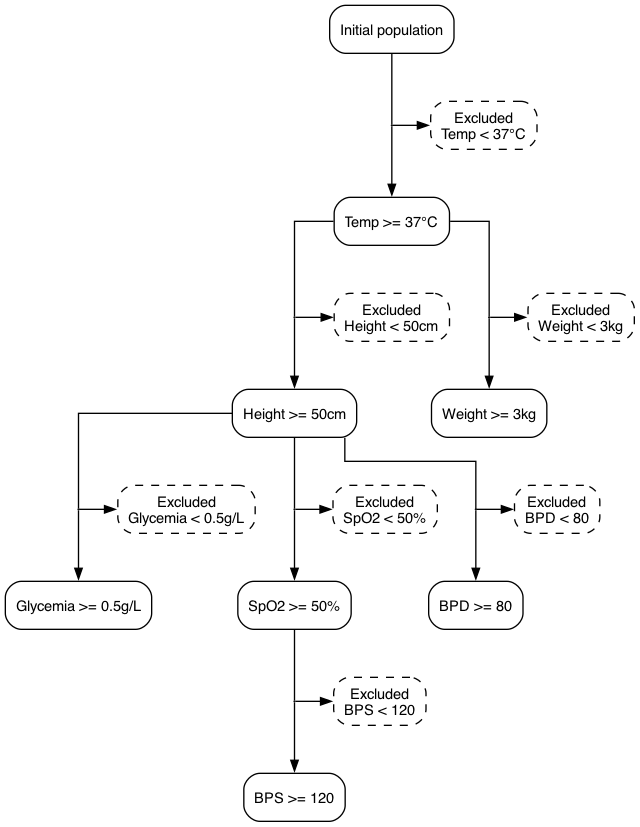
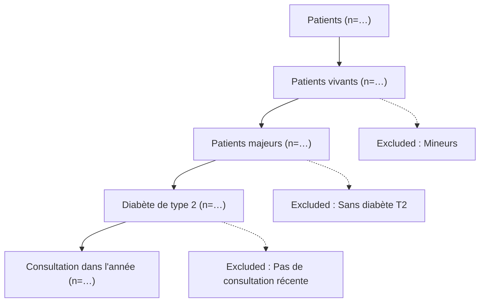

# Onglet `Inclusion`

L'onglet `Inclusion` décrit le **flowchart d'inclusion** : une suite d'étapes, chacune ne gardant
qu'une partie des patients de l'étape précédente.

{ width="480" }

## Le principe

- Chaque **étape** est une boîte du flowchart. Elle est définie par une ligne (ou un
  [groupe de lignes](combiner-blocs.md)) de l'onglet.
- Une étape applique un **bloc** (ex. `Age`) qui calcule une valeur par patient, puis une condition
  (ex. `x>=18`) qui dit si le patient est **retenu** (`TRUE`) ou **exclu** (`FALSE` ou vide).
- Une étape n'est évaluée que sur les patients **retenus par son étape parente**. Le nombre affiché
  `(n=…)` est le nombre de patients retenus ; la boîte « Excluded » affiche la différence avec le parent.
- Tout en haut, une boîte `Patients` indique le nombre total de patients de la base.

!!! important "Une étape d'inclusion doit renvoyer vrai/faux"
    Dans l'onglet `Inclusion`, la valeur finale d'un bloc (après `post_func`) doit être un booléen.
    Les valeurs par défaut des blocs sont prévues pour ça (ex. `Age` → `x>=18`,
    `CIM10` → `x>=1`, c'est-à-dire « au moins un code trouvé »).

## Les colonnes

| Colonne | Obligatoire | Description |
| --- | --- | --- |
| `block_name` | Oui | Nom **unique** de l'étape. Il sert à y faire référence ailleurs (`parent_step`, `reference_date_block`, populations). Préférez des noms courts sans caractères spéciaux (ex. `adultes`, `diabete_t2`). |
| `block_type` | Oui | Le bloc à utiliser, par ex. `Age`, `CIM10`, `Consultations`. Voir le [catalogue](../blocs/index.md). Une ligne sans `block_type` est ignorée. |
| `parent_step` | Non | Le `block_name` de l'étape parente. **Vide = l'étape définie juste au-dessus dans la feuille.** Doit rester vide pour la toute première étape. |
| `text` | Non | Texte affiché dans la boîte du flowchart (ex. `Patients majeurs`). |
| `excluded_text` | Non | Texte de la boîte d'exclusion à droite (ex. `Mineurs`). Vide = pas de boîte d'exclusion. |
| `operator` | Pour les groupes | `AND` ou `OR`, uniquement sur les lignes 2, 3… d'un groupe. Voir [Combiner des blocs](combiner-blocs.md). |
| `expose_date_for_future_references` | Pour les groupes | Case à cocher. Dans un groupe, indique si les dates de cette ligne sont utilisables par `reference_date_block`. Voir [Combiner des blocs](combiner-blocs.md#dates-dun-groupe). |
| `value` | Selon le bloc | La valeur principale du bloc (codes CIM10, libellé de biométrie…). |
| `agg_func` | Non | Comment résumer plusieurs événements d'un patient (ex. `COUNT(x)`). Nécessaire pour les blocs de type ` event` (qui peuvent produire plus d'une valeur par patient)|
| `post_func` | Non | La condition finale (ex. `x>=18`). |
| `date_sql` | Non | Filtre temporel sur les événements. |
| `reference_date_block` | Non | Étape antérieure fournissant une date de référence propre à chaque patient. |
| `reference_date_sql` | Non | Quelle date prendre dans `reference_date_block` (défaut `MIN(start_date)`). |
| `supplementary_params` | Non | Paramètres spécifiques au bloc, au format `{"nom": valeur}`. |

Les colonnes `value` à `supplementary_params` sont détaillées dans [Paramètres des blocs](parametres.md).

## Exemple : une chaîne simple

| block_name | parent_step | text | excluded_text | block_type | value | post_func | date_sql |
| --- | --- | --- | --- | --- | --- | --- | --- |
| `vivants` | | Patients vivants | Décédés | `EstVivant` | | | |
| `adultes` | | Patients majeurs | Mineurs | `Age` | | | |
| `diabete` | | Diabète de type 2 | Sans diabète T2 | `CIM10` | `E11` | | |
| `suivis` | | Consultation dans l'année | Pas de consultation récente | `Consultations` | | | `start_date >= reference_date - INTERVAL '1 year' AND start_date <= reference_date` |

`parent_step` est vide partout : chaque étape s'enchaîne sur la précédente. Le flowchart obtenu est :

## Exemple : des branches

Pour séparer un groupe en plusieurs sous-groupes (« bras »), donnez à plusieurs étapes le **même
parent** :

| block_name | parent_step | text | block_type | value | post_func |
| --- | --- | --- | --- | --- | --- |
| `adultes` | | Patients majeurs | `Age` | | |
| `femmes` | `adultes` | Femmes | `Genre` | | `x = 'féminin'` |
| `hommes` | `adultes` | Hommes | `Genre` | | `x = 'masculin'` |
| `hommes_diab` | `hommes` | Hommes diabétiques | `CIM10` | `E11` | |

`femmes` et `hommes` sont côte à côte sous `adultes`, et `hommes_diab` poursuit la branche `hommes`.

!!! warning "Attention au `parent_step` vide après une branche"
    Un `parent_step` vide signifie « l'étape **écrite juste au-dessus dans la feuille** », pas « la
    dernière étape de la branche principale ». Après avoir défini des branches, renseignez toujours
    explicitement `parent_step`.

## Bonnes pratiques

- **Construisez progressivement** : ajoutez une étape, lancez, vérifiez les effectifs, puis continuez.
- **Gardez des noms stables** : les noms d'étapes sont réutilisés dans les populations et les
  références de date ; les renommer oblige à mettre à jour ces références.
- Une étape ne peut référencer (en `parent_step` ou `reference_date_block`) qu'une étape **située
  plus haut** dans la feuille.
