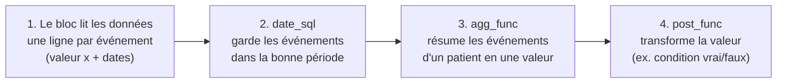

# Paramètres des blocs

Tous les blocs partagent les mêmes colonnes de paramètres : `value`, `agg_func`, `post_func`,
`date_sql`, `reference_date_block`, `reference_date_sql` et `supplementary_params`. Cette page
explique à quoi sert chacune, avec des exemples prêts à copier.

## Comment un bloc calcule sa valeur

Comprendre ce parcours en 4 temps permet de savoir dans quelle colonne agir.



Prenons le bloc `Consultations` pour un patient qui a eu 3 consultations, dont 2 en 2023 :

| Temps | Ce qui se passe | Résultat pour ce patient |
| --- | --- | --- |
| 1. Lecture | Une ligne par consultation, avec sa date. | 3 lignes |
| 2. `date_sql = EXTRACT(YEAR FROM start_date) = 2023` | On ne garde que les consultations de 2023. | 2 lignes |
| 3. `agg_func = COUNT(x)` (défaut) | On compte. | `2` |
| 4. `post_func = x>=1` (défaut) | Au moins une consultation ? | `TRUE` |

Un patient **sans aucune ligne** après l'étape 2 n'a pas de valeur (cellule vide, « null »).
Les conditions sur une valeur vide donnent « vide », qui est traité comme **exclu** dans le flowchart
et comme **missing** dans le tableau descriptif (voir `COALESCE` plus bas).

Les blocs « patient » (`Age`, `Genre`…) ont directement une seule ligne par patient : l'étape 3 n'a
pas lieu (pas d'`agg_func` par défaut).

## `value` : la valeur principale

Son sens dépend du bloc : codes CIM10 pour `CIM10`, libellé de mesure pour `Biometry`, motifs regex
pour `RegexConsultation`… La fiche de chaque bloc indique ce qu'il attend. Certains blocs n'utilisent
pas `value` (`Age`, `Genre`, `Consultations`…) : laissez-la vide.

Pour plusieurs valeurs, séparez-les par `|` : `E11|E10`, ou écrivez une liste `["E11", "E10"]`.

!!! warning "Valeurs qui ressemblent à des nombres"
    Si **toutes** les cellules remplies de la colonne `value` sont des nombres (ex. un seul bloc
    `CodePostal` avec `75011`), Google Sheet les transmet comme des nombres et le bloc échoue avec
    `Input should be a valid list`. Le zéro initial peut aussi disparaître (`06` devient `6`).
    Dans ce cas, écrivez la valeur sous forme de liste : `["75011"]`, `["06"]`.

## La lettre `x`

Dans `agg_func` et `post_func`, **`x` désigne la valeur calculée par le bloc**. Requipso la remplace
automatiquement par la bonne colonne.


## `agg_func` : résumer plusieurs événements

!!! tip "SQL dans `agg_func`"
    Vous pouvez inscrire n'importe quelle expression SQL valide pour `agg_func`

| Formule | Résultat |
| --- | --- |
| `COUNT(x)` | Nombre d'événements. |
| `COUNT(DISTINCT x)` | Nombre de valeurs différentes (ex. nombre de codes CIM10 distincts). |
| `SUM(x)` | Somme. |
| `MIN(x)` / `MAX(x)` | Plus petite / plus grande valeur. |
| `AVG(x)` | Moyenne (`MEAN` n'existe pas, utilisez `AVG`). |
| `MEDIAN(x)` | Médiane. |
| `FIRST(x)` / `LAST(x)` | Valeur du **plus ancien** / du **plus récent** événement (les événements sont triés par date). |

!!! note "On ne peut pas « désactiver » une agrégation par défaut"
    Laisser `agg_func` vide applique la valeur par défaut du bloc (souvent `COUNT(x)`). Pour obtenir
    par exemple *le* code CIM10 d'un patient plutôt que leur nombre, choisissez une autre agrégation
    comme `FIRST(x)` ou `LAST(x)`.

## `post_func` : transformer la valeur finale

!!! tip "SQL dans `post_func`"
    Vous pouvez inscrire n'importe quelle expression SQL valide pour `post_func`.  
    **Par définition, dans l'onglet `Inclusion` cependant, il faut renvoyer un booléen**

| Formule | Signification |
| --- | --- |
| `x` | Garder la valeur telle quelle (indispensable pour une variable numérique ou catégorielle). |
| `x>=18`, `x<5`, `x<>0` | Comparaisons (`<>` signifie « différent de »). |
| `x >= 18 AND x < 65` | Combinaison de conditions (`AND`, `OR`, `NOT`). |
| `x = 'féminin'` | Égalité avec un texte (guillemets simples ou doubles ; `==` est aussi accepté). |
| `x IN ('masculin', 'féminin')` | Appartenance à une liste. |
| `x LIKE 'E11%'` | Le texte commence par `E11` (`%` = n'importe quelle suite de caractères). |
| `x IS NULL` / `x IS NOT NULL` | Pas de valeur / une valeur existe. |
| `COALESCE(x, 0) >= 1` | Remplace l'absence de valeur par 0 avant de comparer : les patients sans événement deviennent `FALSE` au lieu de vide. |
| `ROUND(x, 1)` | Arrondi à 1 décimale. |
| `SUBSTR(x, 1, 2)` | Les 2 premiers caractères (ex. département à partir d'un code postal). |
| `CASE WHEN x >= 65 THEN 'senior' ELSE 'non senior' END` | Créer des catégories. |

## `date_sql` : filtrer dans le temps

`date_sql` est une condition appliquée **à chaque événement, avant l'agrégation**. Elle peut utiliser :

| Nom | Signification |
| --- | --- |
| `start_date` | Date de début de l'événement (ou date unique, ex. date d'une mesure). |
| `end_date` | Date de fin (ex. fin d'une prescription). Si elle est vide (événement en cours), elle vaut la date du jour. |
| `reference_date` | La date de référence (de l'onglet `Project`, ou propre au patient via `reference_date_block`). |

La fiche de chaque bloc précise quelles dates il fournit. Sur un bloc sans date (ex. `Genre`), le
`date_sql` est **ignoré sans message d'erreur**. La formule doit contenir `start_date` ou `end_date`.

### Recettes

| Je veux les événements… | `date_sql` |
| --- | --- |
| avant la date de référence | `start_date <= reference_date` |
| dans l'année précédant la date de référence | `start_date >= reference_date - INTERVAL '1 year' AND start_date <= reference_date` |
| dans les 6 mois après la date de référence | `start_date >= reference_date AND start_date <= reference_date + INTERVAL '6 months'` |
| dans les 90 jours avant | `start_date BETWEEN reference_date - INTERVAL '90 days' AND reference_date` |
| en cours à la date de référence (ex. traitement, médecin traitant) | `start_date <= reference_date AND end_date >= reference_date` |
| depuis une date fixe | `start_date >= DATE '2023-01-01'` |
| d'une année donnée | `EXTRACT(YEAR FROM start_date) = 2023` |

!!! warning "Écrire une date fixe"
    Une date fixe doit être précédée du mot `DATE` et écrite `AAAA-MM-JJ` : `DATE '2023-01-01'`.
    Écrire `start_date >= '2023-01-01'` provoque une erreur.

## Date de référence par patient

Par défaut, tous les patients partagent la date de référence de l'onglet `Project`. Il est souvent
plus pertinent d'utiliser une date **propre à chaque patient**, par exemple « dans l'année qui suit
le premier diagnostic de diabète ».

- `reference_date_block` : le `block_name` d'une étape (ou variable) **définie plus haut**, qui porte
  des dates.
- `reference_date_sql` : quelle date retenir parmi les événements de ce bloc, pour chaque patient.
  Par défaut `MIN(start_date)` (le premier événement). Autres choix : `MAX(start_date)` (le dernier),
  `MAX(end_date)`, `MIN(end_date)`.

**Exemple** : consultations dans l'année qui suit le premier code de diabète.

| block_name | block_type | value | date_sql | reference_date_block | reference_date_sql |
| --- | --- | --- | --- | --- | --- |
| `diabete` | `CIM10` | `E11` | `start_date <= reference_date` | | |
| `suivi_1an` | `Consultations` | | `start_date >= reference_date AND start_date <= reference_date + INTERVAL '1 year'` | `diabete` | `MIN(start_date)` |

Dans `suivi_1an`, `reference_date` vaut, pour chaque patient, la date de son premier code `E11`.

!!! info "Quelles dates sont utilisées ?"
    Seules les dates des événements **retenus** par le bloc référencé sont utilisées : ceux qui ont
    passé son `date_sql`, et uniquement pour les patients qui ont franchi cette étape. Un patient sans
    date dans le bloc référencé n'a pas de date de référence : les filtres temporels l'excluent.

## `supplementary_params` : paramètres spécifiques

Certains blocs ont des options propres (ex. `MedecinTraitant` : ne garder que les médecins traitants
renforcés). Elles s'écrivent sous forme de dictionnaire dans la colonne `supplementary_params` :

```text
{"mtr_only": false, "include_external": true}
```

- Les noms disponibles et leurs valeurs par défaut sont dans la fiche du bloc et dans l'onglet
  `🔒 Definitions`.
- Les vrais/faux s'écrivent `true` / `false` ; les listes `["a", "b"]` ; les textes entre guillemets.
- La saisie est tolérante (guillemets simples acceptés), mais **un nom de paramètre inconnu
  provoque une erreur** (`Extra inputs are not permitted`).
