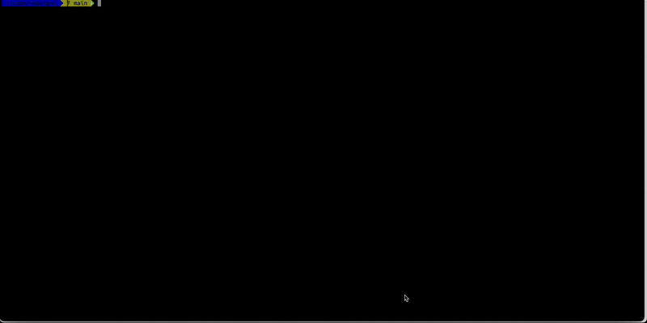
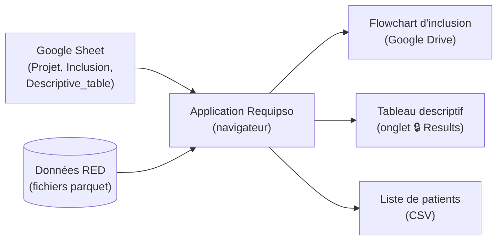

# Requipso

**Requipso** est un requêteur de données de santé pour *ipso*: il permet de construire des « pipelines de requêtes » sur la base RED (dossiers patients ipso) via:  

* Du code Python 
* Directement depuis une feuille Google Sheet.

À partir de la description d'une étude dans un Google Sheet, le requêteur produit :

- un **diagramme d'inclusion** (flowchart de type CONSORT) qui montre, étape par étape, combien de
  patients sont retenus et combien sont exclus ;
- un **tableau descriptif** (le classique « Tableau 1 » d'une publication) qui décrit les populations
  d'intérêt : âge, genre, antécédents, traitements, biométrie… ;
- la **liste des patients** retenus à n'importe quelle étape, exportable en CSV.

## Comment ça marche, en une image

1. Vous décrivez votre étude dans un Google Sheet en assemblant des **blocs** (par exemple « âge ≥ 18 ans »,
   « a un antécédent de diabète », « a eu au moins une consultation dans l'année »).
2. Vous lancez l'application Requipso, choisissez le dossier de données et votre Google Sheet.
3. Requipso exécute les blocs, dessine le flowchart, calcule les statistiques et les réécrit dans votre
   Google Sheet.

!!! danger "Données"
    Pour l'instant, il est nécessaire de disposer des données *en local sur votre ordinateur*. Il est prévu de pouvoir lancer ce requêteur en local mais sur des données distantes, puis directement sur le datalab Onyxia

## Par où commencer ?

- :material-account: **Je veux construire une étude**

    ---

    Le [guide utilisateur](guide/demarrage.md) explique pas à pas comment remplir le Google Sheet et
    lancer l'application. Aucune connaissance technique n'est requise.

- :material-puzzle: **Je cherche un bloc précis**

    ---

    Le [catalogue des blocs](blocs/index.md) décrit chaque bloc : ce qu'il calcule, les données
    utilisées, ses paramètres et des exemples prêts à copier.

- :material-cog: **Je veux contribuer au code**

    ---

    La section [fonctionnement interne](technique/architecture.md) décrit l'architecture, le cycle
    d'exécution d'un bloc et explique comment [ajouter un nouveau bloc](technique/ajouter-un-bloc.md).

## Vocabulaire

| Terme | Signification |
| --- | --- |
| **Bloc** | Brique élémentaire de requête (ex. `Age`, `CIM10`, `Consultations`). Chaque bloc calcule une ou plusieurs valeurs par patient. |
| **Étape** | Une ligne (ou un groupe de lignes) de l'onglet `Inclusion` ; correspond à une boîte du flowchart. |
| **Date de référence** | Date à laquelle on « regarde » les patients (ex. l'âge au 01/01/2024). |
| **Population** | Une étape du flowchart dont les patients forment une colonne du tableau descriptif. |
| **Événement** | Une donnée datée qui peut apparaître plusieurs fois pour un patient (consultation, prescription, mesure…). |
