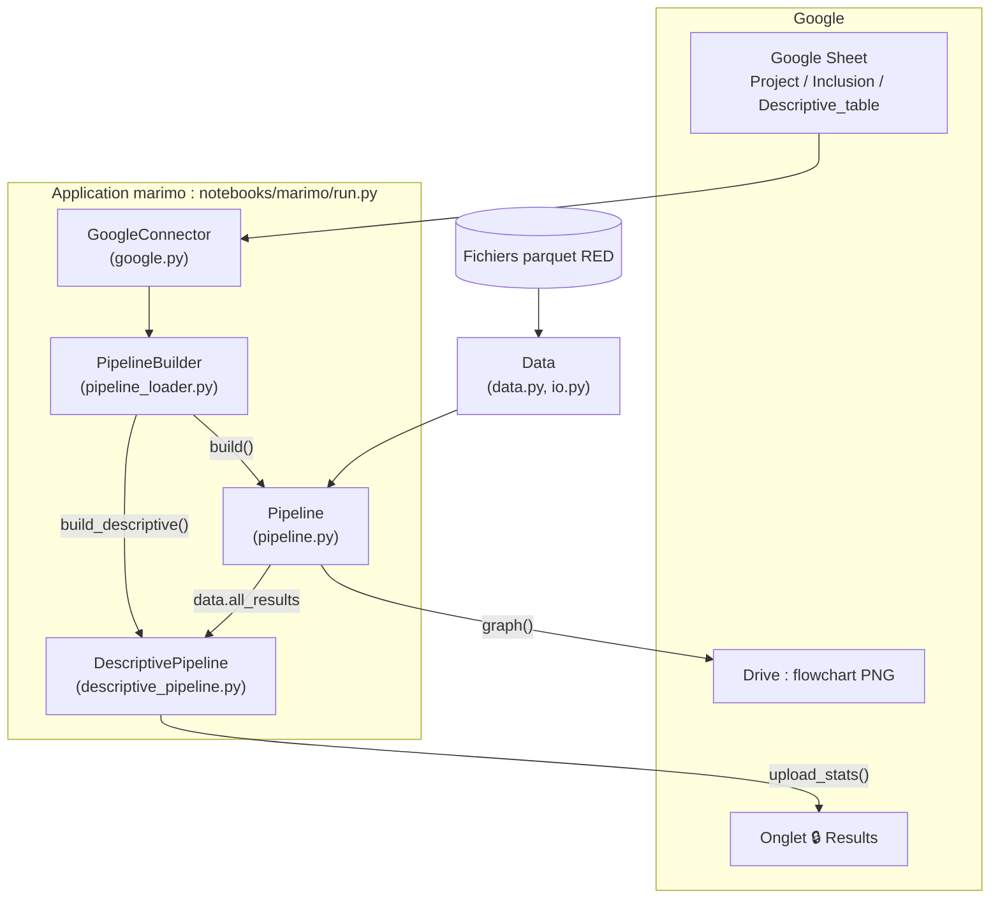

# Architecture

Cette section s'adresse aux contributeurs. Elle décrit comment une définition d'étude dans un Google
Sheet devient un flowchart et un tableau descriptif.

## Vue d'ensemble

Le déroulé d'un clic sur **« (re)lancer la pipeline »** :

1. `GoogleConnector.set_spreadsheet(nom)` ouvre la feuille choisie.
2. `PipelineBuilder(connector).build()` lit les onglets `Inclusion` et `Project`, instancie un bloc
   par groupe de lignes et les ajoute à un `Pipeline` (un graphe orienté).
3. `Pipeline.iter_run(data)` exécute les étapes dans l'ordre du graphe ; chaque bloc écrit ses
   résultats dans `data.all_results`.
4. `Pipeline.graph("graph")` dessine le flowchart (Graphviz), puis `GoogleConnector.upload_file`
   le dépose sur le Drive.
5. `PipelineBuilder.build_descriptive(data, inclusion)` lit `Descriptive_table` et les populations ;
   `DescriptivePipeline.run_iter(data)` calcule chaque variable pour chaque population.
6. `format_stats` met en forme le tableau, `upload_stats` l'écrit dans `🔒 Results`.

## Carte des modules

| Module | Rôle |
| --- | --- |
| `requipso/cli.py` | Point d'entrée `requipso` : lance `marimo run` sur l'application. |
| `requipso/notebooks/marimo/run.py` | L'application marimo (interface utilisateur). |
| `requipso/data.py` | `Data` : charge toutes les tables, stocke les résultats des blocs. |
| `requipso/io.py` | `LocalIO` / `S3IO` : lecture et écriture des tables parquet. |
| `requipso/google.py` | `GoogleConnector` : authentification avec le compte Google de l'utilisateur, Drive, Sheets. |
| `requipso/pipeline_loader.py` | `PipelineBuilder` : traduit les onglets du Sheet en objets Python. |
| `requipso/pipeline.py` | `Pipeline` (graphe d'étapes) et `dag_to_consort_flowchart`. |
| `requipso/descriptive_pipeline.py` | `DescriptivePipeline` : tableau descriptif et upload. |
| `requipso/stats.py` | Statistiques booléennes, catégorielles et quantitatives. |
| `requipso/pipes/base.py` | Hiérarchie des blocs : `BaseBlock`, `TableBlock`, `CombinedBlock`. |
| `requipso/pipes/params.py` | Modèles Pydantic des paramètres (`BlockParams` et dérivés). |
| `requipso/pipes/processors.py` | `RegexProcessor` (edsnlp) et `RegexParams`. |
| `requipso/pipes/{patient,atcd,biometry,form,consultations,insurance,prescription}.py` | Les blocs concrets. |
| `requipso/polars.py` | Namespace Polars `df.ipso` (post-traitements utilitaires). |
| `requipso/completer.py` | Complétion IPython des noms de colonnes dans `pl.col("…")`. |
| `requipso/signature_exporter.py` | Exporte la signature des blocs vers les onglets `🔒 Blocks` / `🔒 Definitions` ([détail](export-signatures.md)). `scripts/signature_exporter.py` le lance en ligne de commande. |
| `requipso/docs/` | Cette documentation (`mkdocs.yml`, pages, `macros.py` qui génère les tableaux de paramètres). |

## Principes de conception

- **Le Google Sheet est l'interface.** Toute la configuration utilisateur passe par des cellules :
  les paramètres sont des chaînes (SQL, listes `a|b`, JSON) validées et converties par Pydantic.
- **Un bloc = une classe.** Les blocs sont découverts automatiquement par introspection
  (`build_block_registry`) : ajouter une classe dans `requipso/pipes/` suffit à la rendre disponible.
- **Les tables nécessaires sont déduites de la signature.** Les noms des arguments de
  `transform(self, patient, biometry)` sont les noms des tables à charger.
- **Tout est Polars.** Les tables sont des `pl.DataFrame` en mémoire ; les expressions utilisateur
  (`agg_func`, `post_func`, `date_sql`) sont converties en expressions Polars via `pl.sql_expr`.
- **Les résultats sont partagés.** Chaque bloc écrit dans `data.all_results[nom]` ; les étapes
  suivantes, les références de dates et le tableau descriptif y lisent.
