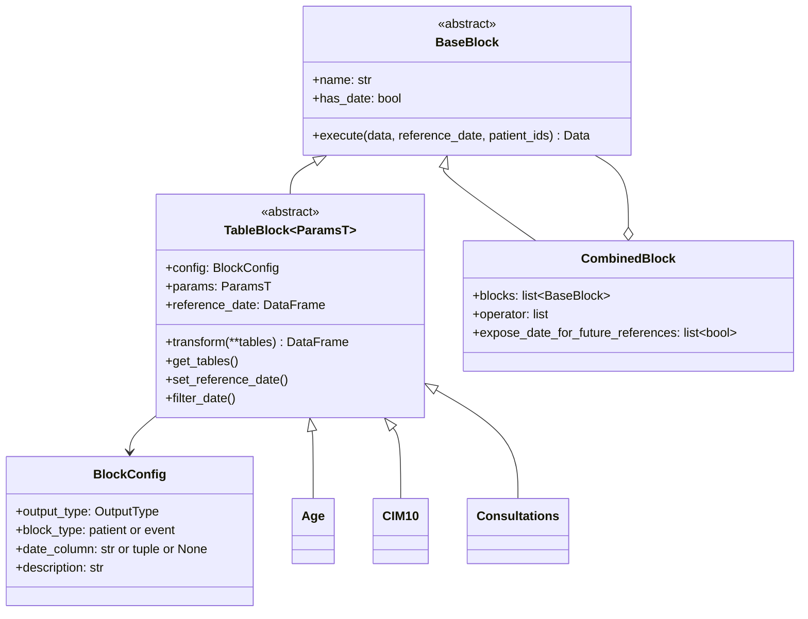
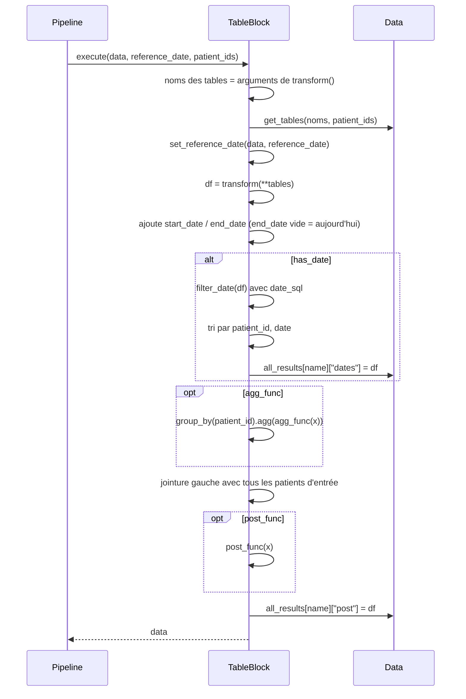
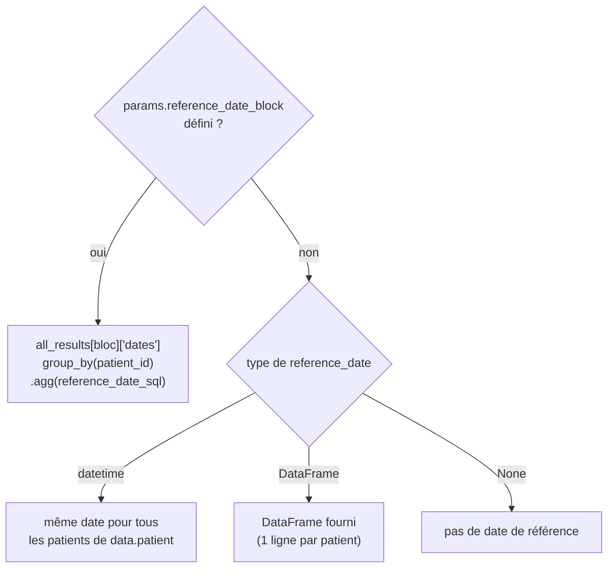

# Les blocs : fonctionnement interne

Tout le code est dans `requipso/pipes/base.py`.

## Hiérarchie



- **`BaseBlock`** définit l'interface commune : `execute(data, reference_date, patient_ids) -> Data`.
  Pipelines et `CombinedBlock` ne manipulent que cette interface.
- **`TableBlock[ParamsT]`** est la base des blocs concrets, qui lisent des tables brutes. Il est
  générique sur sa classe de paramètres : `class Age(TableBlock[AgeParams])`. C'est ce paramètre
  générique que lisent `PipelineBuilder` et `signature_exporter` pour savoir quels paramètres
  instancier.
- **`CombinedBlock`** compose plusieurs blocs booléens avec `AND` / `OR`. Il peut contenir d'autres
  `CombinedBlock`.

## `BlockConfig`

Chaque bloc concret déclare un attribut de classe `config` :

```python
class Age(TableBlock[AgeParams]):
    config = BlockConfig(
        output_type=OutputType.NUMBER,
        block_type="patient",
        date_column="patient_birth_date",
        description="Retourne l'âge du patient en années au moment de la référence.",
    )
```

| Champ | Rôle |
| --- | --- |
| `output_type` | Type de la valeur produite par `transform` (`BOOLEAN`, `NUMBER`, `STRING`, `CATEGORY`). Documentaire aujourd'hui : il n'est pas vérifié à l'exécution. |
| `block_type` | `"patient"` (une ligne par patient) ou `"event"` (plusieurs lignes, à agréger). Documentaire. |
| `date_column` | `None` (pas de date), un nom de colonne (date ponctuelle : début = fin) ou un tuple `(début, fin)`. Active `has_date`, le filtrage `date_sql` et le stockage des dates. |
| `description` | Affichée dans `🔒 Blocks` et dans cette documentation. **En français, destinée aux utilisateurs.** |

## Cycle d'exécution de `TableBlock.execute`



Points importants :

1. **Les tables sont déduites de la signature.** `inspect.signature(self.transform)` donne les noms
   des arguments, qui sont les noms des tables. Elles sont filtrées sur `patient_ids` (les patients
   retenus par l'étape parente) si elles ont une colonne `patient_id`.
2. **`transform` renvoie** un DataFrame contenant au moins `patient_id` et une colonne nommée
   `self.name` (la valeur `x`), plus les colonnes de date déclarées dans `config.date_column`.
3. **Les dates** sont recopiées dans `start_date` / `end_date`. Une `end_date` vide est remplacée par
   la date du jour (événement en cours).
4. **`filter_date`** joint la date de référence par patient (`reference_date`) puis applique
   `pl.sql_expr(date_sql)`. Si les dates portent un fuseau horaire, `reference_date` est aligné dessus.
   Sans `has_date`, `date_sql` n'est jamais évalué.
5. **Le tri** par `patient_id` puis date de début garantit le sens de `FIRST(x)` / `LAST(x)`.
6. **L'agrégation** n'a lieu que si `agg_func` est défini : `group_by("patient_id").agg(agg_func(pl.col(name)))`.
7. **La jointure gauche** sur la liste des patients d'entrée (ou tous les patients) garantit une ligne
   par patient ; les patients sans ligne ont `null`.
8. **`post_func`** est appliqué colonne entière, nulls compris.

## Résolution de la date de référence

`set_reference_date` fixe `self.reference_date`, un DataFrame `(patient_id, reference_date)` :



- `reference_date_sql` vaut `MIN(start_date)` par défaut ; c'est une **agrégation** SQL évaluée par
  patient sur les dates du bloc référencé.
- Les patients absents du bloc référencé n'ont pas de date de référence : la jointure gauche de
  `filter_date` leur donne `null` et toute comparaison les élimine.
- Si le bloc référencé n'a pas de dates, `all_results[bloc]["dates"]` n'existe pas : `KeyError`.

## `CombinedBlock`

```python
CombinedBlock(
    blocks=[CIM10(params=...), CISP2(params=...)],
    operator=["OR"],                          # len(blocks) - 1, ou une seule chaîne
    name="diabete",
    expose_date_for_future_references=[True, True],
)
```

- Le nom par défaut est construit à partir des sous-blocs : `(_A_OR_B)`.
- `execute` exécute chaque sous-bloc sur les **mêmes** `patient_ids`, puis joint leurs colonnes
  `post` et calcule l'expression **de gauche à droite sans priorité** : `((A op1 B) op2 C)`. Les nulls
  sont remplacés par `False`.
- `store_intermediate_results=True` (défaut) conserve les colonnes des sous-blocs dans
  `all_results[name]["post"]`.
- **Dates** : pour chaque sous-bloc daté dont `expose_date_for_future_references` est vrai, ses dates
  (restreintes aux patients pour lesquels il est vrai) sont concaténées dans
  `all_results[name]["dates"]`, et `has_date` du groupe devient vrai.

Dans l'onglet du Sheet, les sous-blocs s'appellent `<nom>_0`, `<nom>_1`, … (voir
[Chargement du Sheet](chargement-sheet.md)).

## Types de valeurs et nulls

| Situation | Valeur de `x` |
| --- | --- |
| Patient sans aucune ligne après `transform` / `date_sql` | `null` |
| `COUNT(x)` sur un patient sans ligne | `null` (pas `0` : la jointure gauche a lieu **après** l'agrégation) |
| `x >= 1` sur `null` | `null` |
| Étape d'inclusion | `filter(pl.col(name))` : `null` est traité comme `False` |
| Tableau descriptif booléen | `null` compté en `missing` |

C'est la raison des recommandations `COALESCE(x, 0)` du guide utilisateur.
