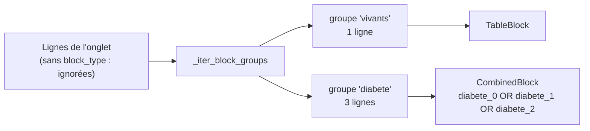

# Chargement du Google Sheet

Le module `requipso/pipeline_loader.py` traduit les onglets du Sheet en objets Python. Son point
d'entrée est `PipelineBuilder`.

```python
from requipso.google import GoogleConnector
from requipso.pipeline_loader import PipelineBuilder

connector = GoogleConnector().set_spreadsheet("Mon étude")
builder = PipelineBuilder(connector)

inclusion = builder.build()                       # Pipeline
inclusion.run(data)
descriptive = builder.build_descriptive(data, inclusion)   # DescriptivePipeline
stats = descriptive.run(data)                     # calcule, formate et uploade
```

## Constantes

| Constante | Valeur |
| --- | --- |
| `PIPELINE_SHEET_NAME` | `"Inclusion"` |
| `DESCRIPTIVE_PIPELINE_SHEET_NAME` | `"Descriptive_table"` |
| `PROJECT_SHEET_NAME` | `"Project"` |
| `COMMON_PARAM_COLUMNS` | `value`, `agg_func`, `post_func`, `reference_date_block`, `reference_date_sql`, `date_sql` |

## Registre des blocs : `build_block_registry`

Au constructeur, `PipelineBuilder` parcourt `requipso.pipes` avec `pkgutil.walk_packages`, importe
chaque module et retient toutes les sous-classes de `TableBlock` définies dans `requipso.pipes.*` :

```python
registry = {"Age": Age, "CIM10": CIM10, ...}   # clé = nom de la classe
```

Le nom de la classe **est** la valeur attendue dans la colonne `block_type`. Un module qui échoue à
l'import est ignoré silencieusement : un bloc absent du registre est souvent le signe d'une erreur
d'import.

## Regroupement des lignes : `_iter_block_groups`



- Les lignes sans `block_type` sont retirées (`dropna(subset="block_type")`).
- Une ligne dont `block_name` est non vide **et différent** du nom courant ouvre un nouveau groupe ;
  sinon elle est rattachée au groupe courant.
- `_extract_operators` exige un `operator` `AND`/`OR` sur chaque ligne de continuation.
- `parse_row_groups` (inclusion) lit `parent_step`, `text` et `excluded_text` sur la **première** ligne
  et collecte `expose_date_for_future_references` sur toutes les lignes (booléen exigé sur les lignes
  de continuation).
- `parse_descriptive_row_groups` lit `variable_type` (validé contre `VARIABLE_TYPE`),
  `variable_description` et `subsets` (parsé par `parse_subsets` : JSON, JSON avec `'`, puis
  `ast.literal_eval`).

## Instanciation : `build_block_from_row`

Pour chaque ligne :

1. `block_cls = registry[row.block_type]` (sinon `Unknown block type`).
2. `params_cls = extract_params_type(block_cls)` lit l'argument générique de `TableBlock[...]` dans
   `__orig_bases__`. S'il n'y en a pas, le bloc est instancié sans paramètres.
3. Les colonnes de `COMMON_PARAM_COLUMNS` non vides sont copiées dans un dictionnaire.
   `reference_date_block` est résolu en **objet bloc** parmi les blocs déjà construits (d'où l'exigence
   qu'il soit défini plus haut).
4. `supplementary_params` est parsé par `parse_supplementary_params` (JSON, normalisation des
   guillemets et des clés non quotées, puis `ast.literal_eval` ; `{}` en cas d'échec, avec un
   avertissement dans les logs) et fusionné dans le dictionnaire.
5. `params_cls(**params_dict)` valide le tout (voir [Paramètres](parametres-internes.md)), puis
   `block_cls(name=name, params=params)`.

`build_block_for_group` renvoie le bloc seul pour un groupe d'une ligne, ou un `CombinedBlock` dont les
sous-blocs s'appellent `<nom>_<i>`.

## `build()` : le pipeline d'inclusion

1. `parse()` relit l'onglet `Inclusion`.
2. `fetch_reference_date()` lit la cellule **B1** de `Project` (`header_rows=0`, donc `iloc[0, 1]`)
   au format `%d/%m/%Y`.
3. Pour chaque groupe : construction du bloc, puis
   `pipeline.add_step(block, text=..., excluded_text=..., parent_step=...)`.

### Branche « sinon » : `Negation` { #branche-sinon-negation }

`Negation` n'est pas un `TableBlock` et n'est pas dans le registre. Quand la première ligne d'un
groupe a `block_type = Negation` (`NEGATION_BLOCK_TYPE`), `build()` appelle `build_negation(group,
pipeline)` au lieu de `build_block_for_group`. Il :

1. lit le nom de l'étape cible dans `value` et la cherche dans `pipeline.steps_names` (elle doit être
   définie plus haut) ;
2. prend son parent avec `pipeline.parent_of(target)` (erreur si la cible est la racine) et l'utilise
   comme `parent_step` ;
3. refuse un groupe de plusieurs lignes, un `parent_step` ou un `excluded_text` renseigné, un
   `excluded_text` sur la cible, et toute autre colonne de paramètre ou `supplementary_params`.

Dans `build_block_from_row` (onglet `Descriptive_table`, ou ligne d'un groupe), `Negation` lève une
erreur.

## `build_descriptive()` : le tableau descriptif

1. `fetch_populations()` lit la ligne 2 de `Project` : A2 doit valoir `Populations`, les cellules
   suivantes non vides sont les noms de population.
2. L'onglet `Descriptive_table` est lu et regroupé.
3. `built_blocks` est **initialisé avec les étapes d'inclusion** (`inclusion_pipeline.steps_names`) :
   une variable peut donc utiliser une étape d'inclusion comme `reference_date_block`.
4. Chaque groupe est ajouté par `descriptive.add_row(step, variable_type, display_name, subsets)`.

## Le hash du pipeline

`fetch_pipeline_df()` calcule `pipeline_hash = pd.util.hash_pandas_object(df).sum()` sur le contenu de
l'onglet `Inclusion`. L'application le compare à la valeur stockée dans un `mo.state` pour éviter de
relancer l'inclusion si l'onglet n'a pas changé.

!!! note "Limite connue"
    Le hash ne couvre que l'onglet `Inclusion` : un changement de date de référence dans `Project`
    ne déclenche pas de recalcul de l'inclusion dans la même session.
