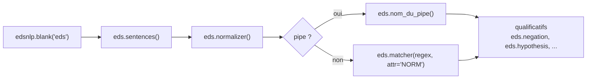

# Traitement du texte : `RegexProcessor`

`requipso/pipes/processors.py` regroupe la logique NLP partagée par les blocs texte. Les blocs
**composent** un `RegexProcessor` (au lieu d'en hériter) :

```python
class RegexConsultation(TableBlock[RegexConsultationParams]):
    def __init__(self, params, name=None):
        super().__init__(name=name, params=params)
        p = params.get_regex_and_pipe()          # {"pattern": ..., "pipe": ...}
        self.processor = RegexProcessor(
            pattern=p["pattern"], qualifiers=params.qualifiers, pipe=p["pipe"]
        )

    def transform(self, consultation):
        notes = ...                               # une ligne par document
        return self.processor.process(
            notes, id_column="consultation_id", text_column="consultation_text",
            output_column_name=self.name,
        )
```

## Construction du pipeline edsnlp



- **`eds.normalizer`** produit l'attribut `NORM` (minuscules, sans accents, guillemets et espaces
  normalisés). Le `matcher` regex travaille sur `NORM` : un motif accentué ne correspond jamais.
- **`get_regex_and_pipe`** : si `value` contient une seule entrée `edsnlp.xxx`, le pipeline `xxx` de
  `edsnlp.pipes` est ajouté à la place du matcher ; sinon les valeurs sont combinées en
  `(?i)(v1|v2|…)`.
- **Qualificatifs** : chaque nom de `qualifiers` est un composant `edsnlp.pipes` ajouté avec une liste
  de terminaisons étendue (`terminations.termination + ["\n-", "\n\t-"]`), pour que les puces de
  liste bornent la portée d'une négation.

!!! note "Effet de bord"
    `termination += [...]` modifie en place la liste globale d'edsnlp : elle grossit à chaque
    instanciation d'un `RegexProcessor` (sans conséquence fonctionnelle connue).

## `process(df, ...)`

1. Copie `id_column` et `text_column` dans `note_id` / `note_text` (format OMOP attendu par edsnlp).
2. `edsnlp.data.from_polars(df, converter="omop", doc_attributes=["patient_id"])`, puis
   `map_pipeline(nlp)` avec le backend **multiprocessing** et une barre de progression.
3. Conversion des entités (`ents`) en dictionnaires, avec les qualificatifs et l'attribut de sortie
   (`lexical_variant` par défaut, ou un attribut personnalisé passé via
   `output_span_attribute_and_dtype`, comme `PA` pour `PaquetAnnees`).
4. Écriture en Polars via `LenientPolarsWriter`.
5. Si aucune entité n'est trouvée, un DataFrame vide au bon schéma est construit.
6. Les entités portant **un** qualificatif vrai sont retirées :
   `ents.filter(~pl.any_horizontal(*qualifiers))`.
7. `note_id` est recopié dans `id_column`, l'attribut de sortie dans `output_column_name`, puis
   `.unique()`.

Le résultat contient une ligne par entité : `patient_id`, l'identifiant du document, `start`, `end`,
`label`, les qualificatifs et la colonne de sortie. Les blocs y joignent ensuite leurs dates
(ex. `RegexConsultation` joint `consultation_start_datetime` / `consultation_end_datetime`).

## `LenientPolarsWriter`

Sous-classe de `edsnlp.data.polars.PolarsWriter`. Le writer d'origine lève une erreur si des colonnes
de `schema_overrides` sont absentes, ce qui arrive quand **aucune entité** n'est trouvée. La version
tolérante ne valide les `schema_overrides` que si le résultat est non vide.

## Points d'attention pour les contributeurs

- Le texte d'un document est construit en Polars : une concaténation avec une colonne `null` donne
  `null`. Remplacez les valeurs manquantes (`fill_null("")`) avant de concaténer, comme le fait
  `RegexConsultation` pour l'observation et la conclusion.
- Le multiprocessing impose que le code appelant soit importable (`if __name__ == "__main__":` dans les
  scripts).
- Pour un attribut personnalisé, l'extension spaCy doit être déclarée avant le traitement
  (`Span.set_extension("PA", getter=..., force=True)` dans `PaquetAnnees`).
