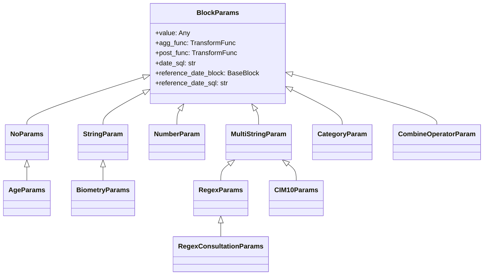

# Les paramètres : `BlockParams`

Tout le code est dans `requipso/pipes/params.py` (et `RegexParams` dans `processors.py`).

## Hiérarchie



| Classe | `value` | Usage |
| --- | --- | --- |
| `NoParams` | `None` (inutilisée) | Blocs sans valeur principale (`Age`, `Genre`, `Consultations`…). |
| `StringParam` | `str`, obligatoire | `Biometry`. |
| `NumberParam` | `int`, obligatoire | Disponible, non utilisé actuellement. |
| `MultiStringParam` | `list[str]`, défaut `[]` ; accepte `"a|b|c"` | Codes (`CIM10`, `ALD`, `PrescriptionATC`…). Fournit `get_regex(case, prefix, exact)`. |
| `CategoryParam` | `str` parmi `allowed` | Disponible, non utilisé actuellement. |
| `CombineOperatorParam` | `None` + `operator` | Hérité, non utilisé par `CombinedBlock`. |
| `RegexParams` | `list[str]` (motifs ou `edsnlp.<pipe>`) + `qualifiers` | Blocs NLP. |

Chaque bloc définit sa propre sous-classe pour **surcharger les valeurs par défaut** (et la
description du champ `value`, préfixée par `[HELP]` pour l'aide du Sheet) :

```python
class CIM10Params(MultiStringParam):
    value: list[str] = Field(
        default=[],
        description="[HELP] Code CIM10 / Codes CIM10 séparés de '|' / Liste de codes CIM10",
    )
    agg_func: TransformFunc = Field(default="COUNT(x)", description="Aggregation function.")
    post_func: TransformFunc = Field(default="x>=1", description="Post-transform: True if at least one match.")
```

Les champs spécifiques (ex. `mtr_only` de `MedecinTraitantParams`) sont de simples champs Pydantic
supplémentaires ; ils arrivent depuis la colonne `supplementary_params`.

## Configuration Pydantic

```python
model_config = ConfigDict(
    extra="forbid",                 # paramètre inconnu => erreur
    arbitrary_types_allowed=True,   # reference_date_block est un BaseBlock
    validate_default=True,          # les défauts SQL passent aussi par parse_func
    coerce_numbers_to_str=True,     # 75011 -> "75011" pour les champs str
)
```

## Coercition des cellules : `_coerce_sheet_values`

Validateur `mode="before"` appliqué au dictionnaire brut issu du Sheet :

| Entrée | Résultat |
| --- | --- |
| `None` ou chaîne vide | Clé **supprimée** : la valeur par défaut du champ s'applique. |
| Chaîne commençant par `[` ou `{` | Parsée avec `json.loads`, puis `json.loads` après remplacement `'` → `"`, puis `ast.literal_eval`. Sinon laissée telle quelle. |
| `"true"` / `"false"` (toute casse) | Booléen. |
| Autre chaîne | Débarrassée des espaces de bord. |
| Non-chaîne (nombre, booléen) | Inchangée. |

Conséquence : **une cellule vide ne peut pas annuler un défaut** (ex. supprimer le `COUNT(x)` par
défaut d'un bloc).

## Expressions SQL utilisateur

### `agg_func` / `post_func` → `TransformFunc`

`parse_func` (validateur `before`) accepte une chaîne SQL ou un callable :

1. la chaîne est validée immédiatement par `pl.sql_expr(func)` ;
2. elle est enveloppée dans `partial(sql_to_polars_expr, sql=func)`, un callable `pl.Expr -> pl.Expr`.

`sql_to_polars_expr(col, sql)` :

```python
expression = parse_one(sql.replace('"', "'"))       # sqlglot
expression = expression.transform(                    # x -> nom réel de la colonne
    lambda node: exp.column(col.meta.output_name())
    if isinstance(node, exp.Column) and node.name == "x" else node
)
return pl.sql_expr(expression.sql())
```

- Les guillemets doubles sont convertis en simples : `"féminin"` est un littéral, pas un identifiant.
- Seule la colonne `x` est réécrite. Les autres identifiants sont laissés tels quels et résolus par
  Polars dans le contexte d'évaluation.

Côté code, on peut aussi passer directement un callable :

```python
AgeParams(post_func=lambda x: x.is_between(18, 65))
```

### `date_sql` / `reference_date_sql`

Validées par `validate_date_sql` : la chaîne doit contenir `start_date` ou `end_date` et être
acceptée par `pl.sql_expr`. Elles restent des chaînes et sont évaluées dans `filter_date`
(`df.filter(pl.sql_expr(date_sql))`) et `set_reference_date`
(`.agg(pl.sql_expr(reference_date_sql))`).

## `MultiStringParam.get_regex`

Construit un motif à partir de la liste `value` :

| Appel | Motif pour `["E11", "E10"]` | Utilisé par |
| --- | --- | --- |
| `get_regex(prefix=True)` | `^(?:E11|E10)` | `CIM10`, `CISP2`, `PrescriptionATC` |
| `get_regex(exact=True)` | `^(E11|E10)$` | `ALD` |
| `get_regex()` | `(E11|E10)` | |
| `get_regex(case=False)` | `(?i)(E11|E10)` | `RegexParams.get_regex_and_pipe` |

Les valeurs ne sont **pas échappées** : ce sont des expressions régulières (d'où `30.*` pour l'ALD).

## Validateurs spécifiques

| Classe | Validateur | Effet |
| --- | --- | --- |
| `MultiStringParam` | `parse_pipe_separated` | `"a|b"` → `["a", "b"]`. |
| `ALDParams` | `pad_with_zeros` | `8` → `08`, `6.1` → `06.1`. |
| `RegexParams` | `check_if_value_is_edsnlp_pipe` | Si une seule valeur `edsnlp.xxx`, vérifie que `xxx` existe dans `edsnlp.pipes`. |
| `RegexPatientObservationParams` | `parse_patient_observation_label` | Une chaîne seule → liste. |
| `CategoryParam` | `validate_choice` | `value` doit être dans `allowed`. |
