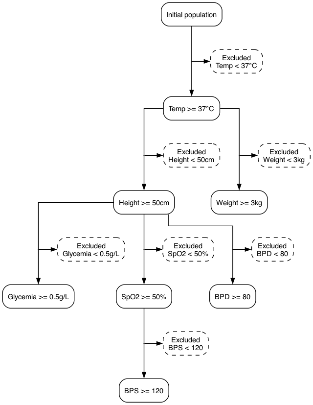

# Le pipeline d'inclusion

`requipso/pipeline.py` contient `Pipeline`, le graphe des étapes d'inclusion, et
`dag_to_consort_flowchart`, qui le dessine.

## Construction : `add_step`

`Pipeline` stocke les étapes dans un `networkx.DiGraph` dont les nœuds sont les **objets blocs**.

```python
pipeline = Pipeline(reference_date=datetime.datetime(2024, 12, 31))
pipeline.add_step(EstVivant(), text="Patients vivants", excluded_text="Décédés")
pipeline.add_step(Age(), text="Patients majeurs", excluded_text="Mineurs")   # parent implicite
pipeline.add_step(Genre(), text="Femmes", parent_step="Age")                # parent explicite
```

| Règle | Détail |
| --- | --- |
| Première étape | Devient `source_step` ; un `parent_step` est interdit. |
| `parent_step=None` | Parent = `last_addded_step`, la dernière étape **ajoutée**. |
| `parent_step` en chaîne | Résolu via `steps_names` ; doit exister. |
| Noms | Uniques (`Step … already exists`). |

Les attributs de nœud `text`, `excluded_text` et, après exécution, `n` servent au dessin.
`parent_of(step)` renvoie le parent d'une étape (`None` pour la racine).

## Branche « sinon » : `Negation` { #branche-sinon-negation }

`Negation(target, name)` (`requipso/pipes/base.py`) est un `BaseBlock` qui vaut vrai pour les patients
reçus que `target` n'a pas retenus :

```python
pipeline.add_step(CIM10(name="diabete", ...), parent_step="adultes")
pipeline.add_step(Negation(target=diabete_block, name="non_diabete"), parent_step="adultes")
```

- Il doit être ajouté avec le **même parent** que `target`. Il reçoit donc les mêmes `patient_ids`
  et `n(target) + n(negation) = n(parent)`. Le loader s'en charge (voir
  [Chargement du Sheet](chargement-sheet.md#branche-sinon-negation)).
- L'univers est `patient_ids`, pas le `post` de `target` : le `post` d'un `CombinedBlock` contient
  tous les patients de la base (à `False` hors entrée).
- `target` doit être exécuté avant. `dfs_preorder_nodes` visite les enfants dans l'ordre d'ajout des
  arêtes, et `target` est toujours ajouté avant ; sinon `execute` lève une erreur.
- `has_date` reste `False`.

## Exécution : `iter_run`

```python
for step_name, n in pipeline.iter_run(data):
    print(step_name, n)
```

- Parcours en **profondeur** (`nx.dfs_preorder_nodes`) depuis `source_step` : un parent est toujours
  exécuté avant ses enfants.
- Pour chaque étape, `input_patients` = patients pour lesquels la colonne du parent est vraie dans
  `all_results[parent]["post"]` (ou `None`, c'est-à-dire tous les patients, pour la racine).
- `step.execute(data, patient_ids=input_patients, reference_date=self.reference_date)`.
- `output_patients` = patients pour lesquels la colonne de l'étape est vraie (`null` → exclu).
- Si l'étape a des dates, `all_results[step]["dates"]` est restreint aux `output_patients` : les
  références de date ultérieures ne voient que les patients inclus.
- `n` est stocké sur le nœud ; `initial_n` (boîte « Patients ») = nombre de patients de la base.

`iter_run` est un générateur pour que l'application puisse afficher une barre de progression ;
`run(data)` le consomme entièrement.

!!! note "Sortie booléenne"
    `iter_run` contient un contrôle de type de sortie (`OutputType.BOOLEAN`) qui n'est pas encore
    branché sur le bloc : une étape non booléenne échoue au moment du `filter(pl.col(name))`.

## Dessin : `dag_to_consort_flowchart`

`Pipeline.graph(save_name)` appelle `dag_to_consort_flowchart` et rend un PNG `save_name.png` avec
Graphviz.

Mise en page de type CONSORT :

- une colonne principale de haut en bas (`rankdir=TB`, arêtes orthogonales) ;
- un nœud virtuel `_source` (« Patients (n=…) ») au-dessus de la racine ;
- pour une étape avec `excluded_text`, un point invisible `_mid_<id>` est inséré sur l'arête entrante,
  et une boîte pointillée `_exc_<id>` (« Excluded … (n=parent − enfant) ») est placée au même rang ;
- plusieurs enfants d'un même parent sont placés côte à côte (`rank=same`).

{ width="420" }

La fonction est indépendante de Requipso : elle accepte n'importe quel `nx.DiGraph` acyclique dont
les nœuds ont des attributs `text`, `n` et `excluded_text`.
